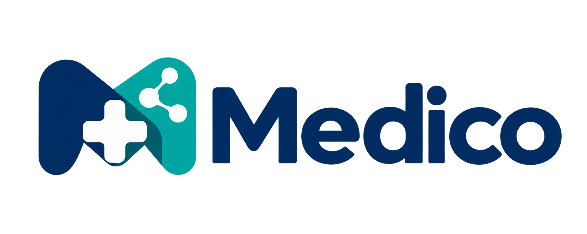

# 🩺 Medico — Healthcare Management & Teleconsultation Platform



> **Care that connects. Your care. Your time. Your Medico.**  
> *A comprehensive, interactive 34-screen Flutter healthcare UI prototype featuring multi-role workflows.*

[](https://flutter.dev)
[](https://dart.dev)


---

## 📸 Visual Showcase & Assets

| 🏥 Emergency & Medical Kit | 👨‍⚕️ Verified Doctor Profiles | ✨ Medico Brand Identity |
|:---:|:---:|:---:|
|  |  |  |
| *Core Branding & 3D Visual* | *Telemedicine Consultation Hub* | *Modern Teal & Navy Styling* |

### 👨‍⚕️ Verified Doctors Catalog


---

## 📖 Overview

**Medico** is a complete, connected UI/UX demonstration built with Flutter. It models an end-to-end telemedicine and healthcare management ecosystem with **3 distinct user roles**: **Patient**, **Doctor**, and **Admin**. 

Designed with a modern **Teal & Navy** medical design language, the app features rich interactive flows, in-memory state simulation, and instant role switching without requiring backend dependencies.

---

## ✨ Key Features & User Roles

```
┌──────────────────────────────────────────────────────────┐
│                      MEDICO PLATFORM                     │
├────────────────────┬────────────────────┬────────────────┤
│ 👤 Patient (24)    │ 🩺 Doctor (6)      │ 🛡️ Admin (4)   │
├────────────────────┼────────────────────┼────────────────┤
│ • Onboarding & Auth│ • Doctor Dashboard │ • System Stats │
│ • AI Symptom Triage│ • Availability Hub │ • Doctor Review│
│ • Doctor Search    │ • Request Manager  │ • User Controls│
│ • Video & Chat     │ • E-Prescriptions  │ • Ticket Res.  │
│ • Health Records   │ • Patient History  │                │
│ • Dermatology AI   │ • Verification Doc │                │
└────────────────────┴────────────────────┴────────────────┘
```

### 👤 1. Patient Experience (24 Screens)
* 🚀 **Onboarding & Auth**: Splash, welcome tours, validated login, sign up, and password reset.
* 🏠 **Patient Dashboard**: Dynamic home screen, greeting, appointment reminders, and quick actions.
* 🤖 **AI Symptom Checker & Guidance**: Interactive symptom analysis and AI triage recommendations.
* 👨‍⚕️ **Doctor Search & Booking**: Specialty filter, detailed doctor profiles, calendar-based date/time booking, and conflict checking.
* 📹 **Teleconsultation Suite**: Simulated video call interface with mic/camera/speaker controls and real-time doctor chat.
* 📋 **Prescriptions & Records**: E-Prescription viewing, clipboard export, and organized digital health records.
* 📸 **Dermatology / Skin Photo AI**: Skin concern capture flow, photo review, and image assessment guide.

### 🩺 2. Doctor Portal (6 Screens)
* 📊 **Doctor Dashboard**: Upcoming appointments, active consultation counts, and profile metrics.
* 🕒 **Availability Management**: Interactive schedule manager and dynamic slot configuration.
* 📩 **Appointment Requests**: Approve, reject, and reschedule incoming consultation requests.
* 📁 **Patient History**: Access patient records, past consult notes, and diagnoses.
* ✍️ **E-Prescription Creator**: Digital prescription writer with instant publishing to patient view.
* 🛡️ **Doctor Verification**: Medical license and document submission workflow.

### 🛡️ 3. Admin Center (4 Screens)
* 📈 **Admin Overview**: System analytics, active users, and verification queue.
* 🔍 **Verification Review**: Evaluate doctor credentials with instant approval/rejection actions.
* 👥 **User Management**: Search, view, and toggle user account statuses.
* 🚨 **Complaints & Grievances**: Review support tickets and resolve user disputes.

---

## 🗂️ Project Structure

```text
medico/
├── 📱 android/              # Android platform configuration
├── 🌐 web/                  # Web host files
├── 🎨 assets/               # Bundled local branding and assets
│   ├── icons/               # Medical SVG icons
│   └── images/
│       ├── medico-logo.png      # Brand Logo
│       ├── medical-kit-3d.png   # 3D Medical Kit Hero Graphic
│       ├── doctor-portrait.png  # Doctor Profile & Consultation
│       └── doctor-crop-0*.png   # Doctor avatars catalog
├── 🧪 test/                 # Smoke tests and core interaction test suites
└── 📦 lib/
    ├── 🚀 main.dart         # Main entry point (`MedicoApp`)
    ├── ⚙️ medico.dart       # Design system, theme, shared state, and route registry
    └── 📑 screens/          # 34 Modular Presentation Screens
        ├── 01_splash.dart
        ├── 02_welcome.dart
        ├── ...
        ├── 23_doctor_dashboard.dart
        ├── ...
        └── 34_image_assessment.dart
```

---

## 🚀 Getting Started

### 📋 Prerequisites
* [Flutter SDK](https://docs.flutter.dev/get-started/install) (`>= 3.6.0`)
* [Dart SDK](https://dart.dev/get-dart)
* Android Studio / VS Code with Flutter extension
* An Android Emulator or physical device / Chrome browser

---

### 💻 Installation & Setup

1. **Clone or Navigate to the project directory**:
   ```bash
   cd medico
   ```

2. **Generate platform files (Optional / Recommended)**:
   > 💡 *If you want to sync Gradle/Android versions with your installed Flutter SDK:*
   ```powershell
   powershell -ExecutionPolicy Bypass -File .\setup.ps1
   ```

3. **Install dependencies**:
   ```bash
   flutter pub get
   ```

4. **Run the App**:
   * **On Android Emulator/Device**:
     ```bash
     flutter run
     ```
   * **On Web (Chrome)**:
     ```bash
     flutter run -d chrome
     ```

---

## 🧭 Live Demo Navigation

* **Grid Quick-Switch**: Tap the **Grid Icon (▦)** in the top app bar on any screen to jump directly to any of the **34 screens**.
* **Role Switching**: On the Sign-in screen, toggle between **Patient**, **Doctor**, and **Admin** to explore each workflow seamlessly.
* **In-Memory State**: Data (appointments, chats, prescriptions) updates dynamically in memory during the active session.

---

## 🧪 Testing & Code Quality

Run static analysis and automated test suites:

```bash
# Static analysis
flutter analyze

# Run unit and widget smoke tests
flutter test
```

---

## 🎨 Design System & Highlights

* **Primary Colors**: Navy Blue (`#0F172A`) & Medical Teal (`#0D9488`)
* **Accent Elements**: Soft Mint Pale (`#E0F2F1`) & Clean White Cards
* **Architecture**: Modular part-file screen architecture with unified state provider
* **Assets**: 100% self-contained local vector & raster assets (`assets/images/`)

---

  
*Made with ❤️ for modern healthcare innovation.*
